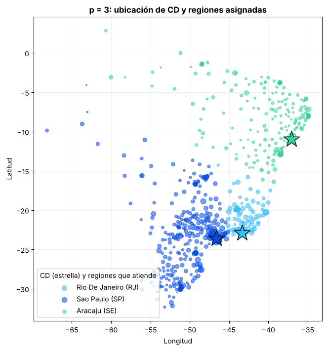

# ¿Dónde ubicar centros de distribución para reducir el flete? · Caso Olist

Trabajo final grupal del curso **Analítica Prescriptiva** (Pacífico Business School).

**Integrantes:** Beatriz Landeo Pariona · Isabel Makishi Maeireizo

## Resumen

Olist es una empresa brasileña de comercio electrónico. Hoy cada vendedor despacha desde su ciudad: el 71 % de los ítems sale de São Paulo, pero solo el 42 % de los clientes vive ahí. Por eso un envío recorre en promedio 587 km y el flete anual llega a R$ 1.71 millones.

Este proyecto propone **dónde abrir centros de distribución (CD)** para reducir el flete de última milla, combinando tres herramientas:

| Pregunta | Herramienta |
|---|---|
| ¿Cuánto costaría enviar desde un CD que aún no existe? | Regresión sobre 109,640 fletes reales |
| ¿Dónde y cuántos CD abrir? | Modelo p-mediana en PuLP (solver CBC) |
| ¿La decisión se mantiene si cambian la demanda y los costos? | Simulación Monte Carlo (1,000 años) |

## Resultados principales

- Con **3 CD en São Paulo, Rio de Janeiro y Aracaju**, el flete de última milla baja **14.5 %** (≈ R$ 242 mil al año).
- La distancia promedio por envío baja de 587 a 315 km y la entrega estimada, de 11.9 a 10.2 días.
- Desde el tercer CD el ahorro marginal cae (R$ 117 mil el 2.º, R$ 42 mil el 4.º, R$ 17 mil el 8.º).
- En 1,000 años simulados el ahorro queda entre R$ 225 y 259 mil (90 % de los casos), y la misma terna es óptima en el 100 % de los años.
- Regla de decisión: abrir el CD número *p* solo si su costo anual (operación + transporte desde los vendedores) es menor que su ahorro marginal.



## Modelo de optimización (p-mediana)

- **Conjuntos:** 848 regiones de demanda (CEP de 3 dígitos) y 27 capitales candidatas.
- **Variables:** `y_j` ∈ {0,1} abre un CD en la capital *j*; `x_ij` ∈ [0,1] fracción de la región *i* atendida desde *j*.
- **Objetivo:** minimizar Σ c_ij · x_ij, donde c_ij es el flete anual estimado con la regresión  
  `flete = 9.84 + 7.92·(km/1000) + 1.82·kg + 1.33·(km/1000)·kg` (R² = 0.55).
- **Restricciones:** Σ_j x_ij = 1 · x_ij ≤ y_j · Σ_j y_j = p.

## Estructura del repositorio

```
notebooks/Olist_CD_Optimizacion.ipynb   Notebook completo (ejecutable en Google Colab)
src/Olist_CD_Optimizacion.py            Mismo código como script de Python
figuras/                                Gráficos generados por el notebook
presentacion/Olist_CD_Presentacion.pptx Presentación final
requirements.txt                        Librerías necesarias
```

## Cómo ejecutarlo

**Google Colab:** abre `notebooks/Olist_CD_Optimizacion.ipynb` y elige *Entorno de ejecución → Ejecutar todo*. Los datos se descargan solos desde el repositorio oficial de Olist; no hay que subir archivos.

**Local:**

```bash
pip install -r requirements.txt
python src/Olist_CD_Optimizacion.py
```

> PuLP se fija en la versión 2.9.0 porque versiones más nuevas eliminaron `LpVariable.dicts`, que usa el modelo.

## Limitaciones

- La regresión explica el 55 % de la variación del flete.
- No se incluye el costo de operar un CD ni el transporte vendedor → CD (no son públicos); por eso se entrega una regla de punto de equilibrio.
- Distancias en línea recta, CD sin límite de capacidad y solo capitales como candidatas.
- Muestra de pedidos de 2016 a 2018.

## Fuentes

- Olist. (2019). *work-at-olist-data* [Conjunto de datos y repositorio, licencia MIT]. GitHub. https://github.com/olist/work-at-olist-data
- Olist. (2018). *Brazilian E-Commerce Public Dataset by Olist* [Conjunto de datos]. Kaggle. https://www.kaggle.com/datasets/olistbr/brazilian-ecommerce
- Hakimi, S. L. (1964). Optimum locations of switching centers and the absolute centers and medians of a graph. *Operations Research, 12*(3), 450–459.
- Efron, B., & Tibshirani, R. J. (1993). *An introduction to the bootstrap*. Chapman & Hall.
- Mitchell, S., O'Sullivan, M., & Dunning, I. (2011). *PuLP: A linear programming toolkit for Python*. The University of Auckland.
